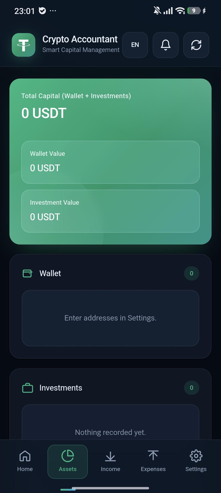
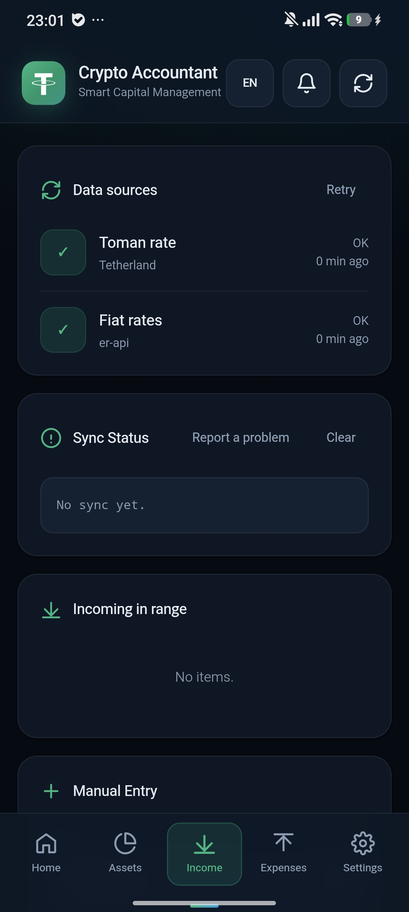
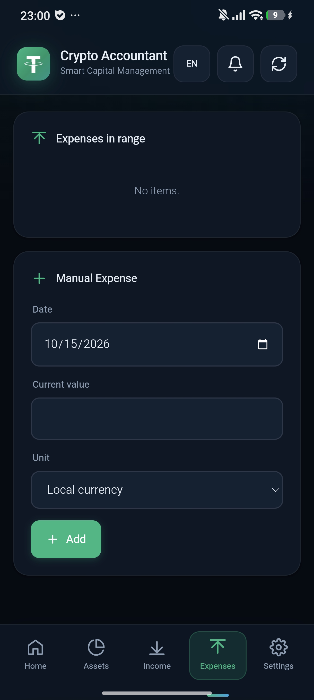
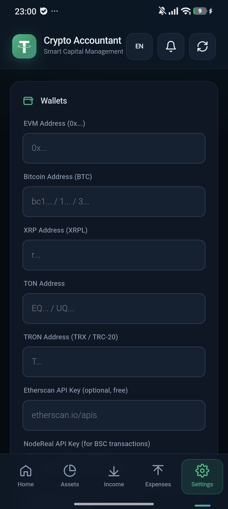
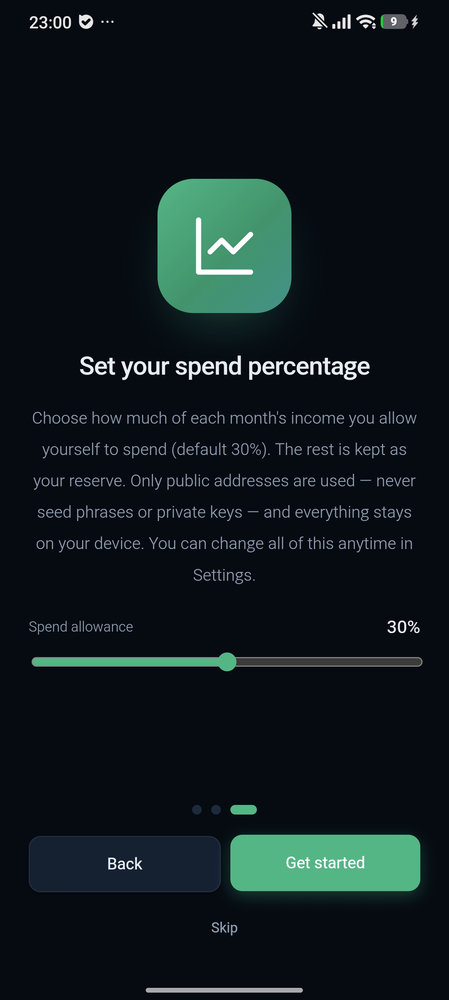
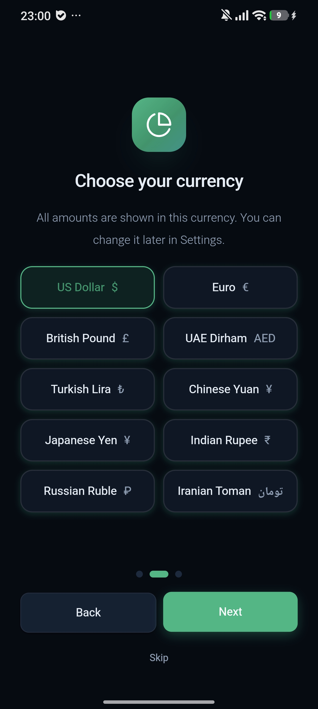

# 💚 Crypto Accountant

**Track your crypto income and know exactly how much to cash out.**

Ready-to-install builds only — the app source code is private.

[English](#english) · [فارسی](#persian)

---

## 🇬🇧 English

### ⬇ Download

Get the latest version from the **[Releases page](../../releases/latest)**.

| Platform | File | Notes |
|---|---|---|
| 📱 Android 6+ | `Crypto-Accountant-1.0.apk` | During install, allow "Install from unknown sources" for your browser or file manager. |
| 🖥️ Windows 10/11 (64-bit) | `Crypto-Accountant-1.0-Windows.exe` | Portable, no installation needed. If SmartScreen warns you: **More info → Run anyway**. |

### 📸 Screenshots

  
  
  
  
  
  

### 🔒 Security & Privacy

- 🗄️ All data stays **on your device only**. There is no server.
- 🔑 App lock with password, AES-GCM encrypted backups, and a hide-balance mode.
- 👁️ The app reads **public** wallet addresses only. It never asks for private keys or recovery phrases.
- 🚫 No ads, no tracking, no account required.

> **Note:** This repository is for distributing installers (APK / EXE) only. The source code is kept in a private repository and is not published.

### 👤 Author

Made by **[IArshiadev](https://github.com/IArshiadev)**. Bug reports and suggestions are welcome via [Issues](../../issues).

---

## 🇮🇷 فارسی

### 💚 حسابدار کریپتو

**درآمد کریپتوی خود را ثبت کنید و بدانید دقیقاً چقدر باید برداشت کنید.**

### ⬇ دانلود

آخرین نسخه را از صفحهٔ **[Releases](../../releases/latest)** دانلود کنید.

| سیستم | فایل | راهنما |
|---|---|---|
| 📱 اندروید ۶ به بالا | `Crypto-Accountant-1.0.apk` | هنگام نصب، گزینهٔ «نصب از منابع ناشناس» را برای مرورگر یا فایل‌منیجر فعال کنید. |
| 🖥️ ویندوز ۱۰/۱۱ (۶۴ بیتی) | `Crypto-Accountant-1.0-Windows.exe` | پرتابل و بدون نیاز به نصب. اگر SmartScreen هشدار داد: **More info ← Run anyway** |

### 📸 تصاویر برنامه

  
  
  
  
  
  

### 🔒 امنیت و حریم خصوصی

- 🗄️ همهٔ داده‌ها فقط روی دستگاه خودتان می‌ماند و هیچ سروری وجود ندارد.
- 🔑 قفل برنامه با رمز، بکاپ رمزنگاری‌شدهٔ AES-GCM و قابلیت مخفی‌کردن موجودی.
- 👁️ برنامه فقط آدرس‌های **عمومی** کیف پول را می‌خواند و هرگز کلید خصوصی یا عبارت بازیابی نمی‌خواهد.
- 🚫 بدون تبلیغ، بدون رهگیری و بدون نیاز به حساب کاربری.

> **توجه:** این مخزن فقط برای انتشار فایل‌های نصبی (APK / EXE) است. کد برنامه در یک مخزن خصوصی نگهداری می‌شود و منتشر نمی‌شود.

### 👤 سازنده

ساخته‌شده توسط **[IArshiadev](https://github.com/IArshiadev)**. برای گزارش خطا و پیشنهاد، از بخش [Issues](../../issues) استفاده کنید.

